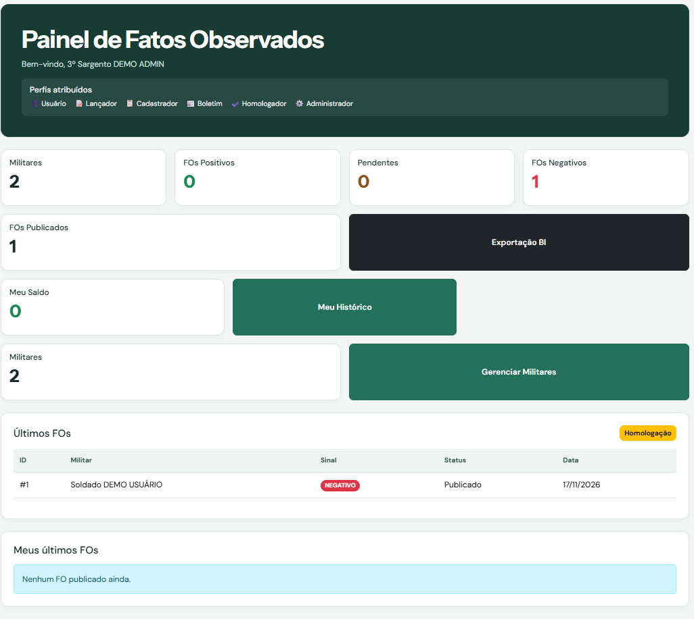
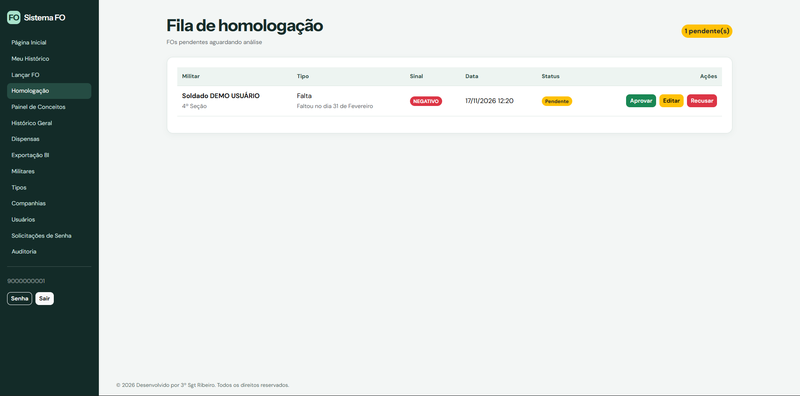
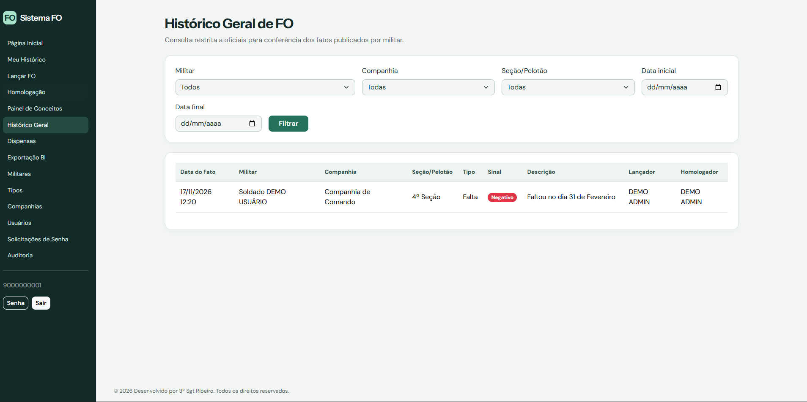
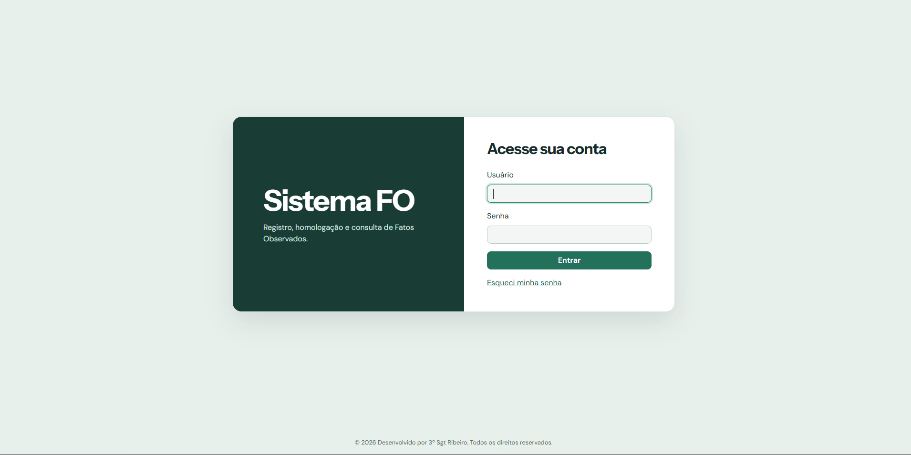
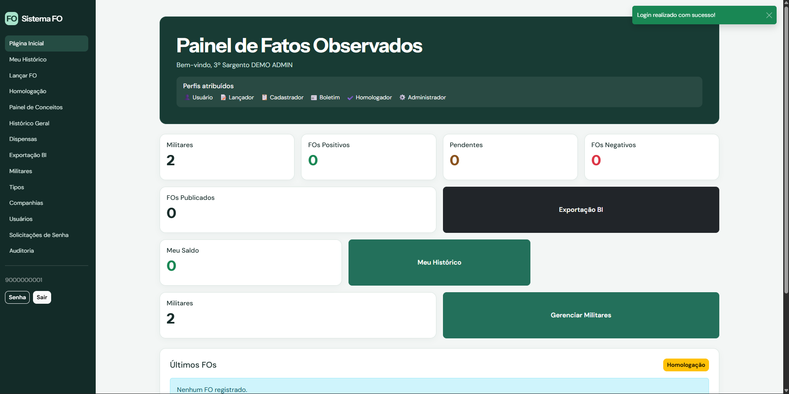
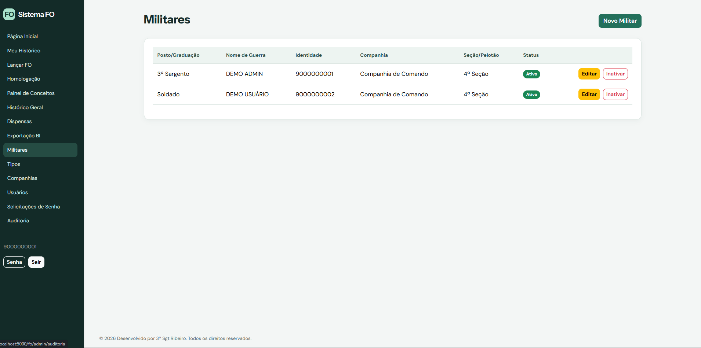
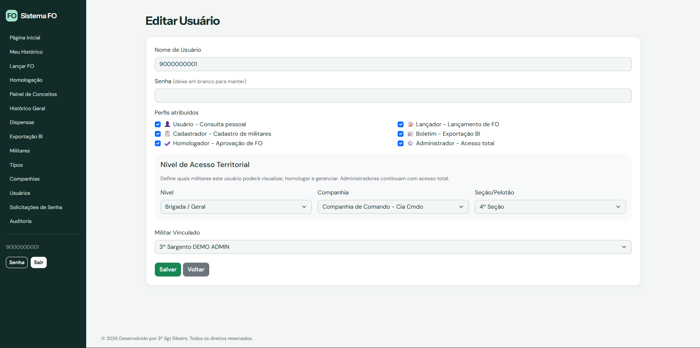
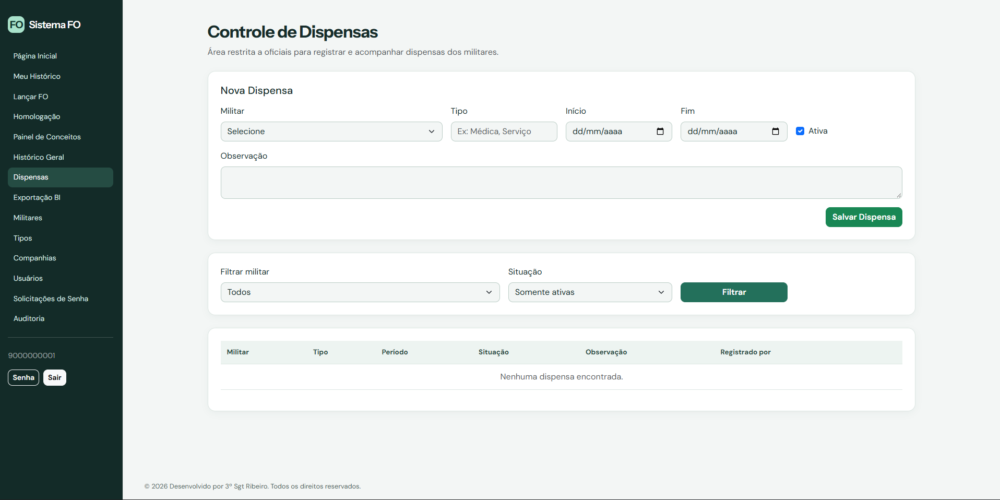

# Controle FO

O **Controle FO** é um sistema web para registrar e acompanhar **Fatos Observados (FOs)**. Ele reúne lançamento, homologação, publicação e consulta em um fluxo com permissões por perfil. Um fato registra o militar, a classificação positiva ou negativa e a descrição da ocorrência. A equipe responsável pode revisar os registros pendentes e consultar os fatos publicados com filtros por militar, companhia, seção ou período.



## O que o sistema faz

| Área | Como é usada |
| --- | --- |
| **Lançamento** | Registra o fato para um militar, com tipo, sinal e descrição. |
| **Homologação** | Apresenta os registros pendentes para aprovação, edição ou recusa. |
| **Consulta** | Reúne histórico pessoal, histórico geral e painel de conceitos. |
| **Boletim** | Disponibiliza a exportação BI aos perfis com permissão. |
| **Administração** | Gerencia militares, tipos de fato, companhias e usuários. Inclui registro de dispensas, auditoria e solicitações de redefinição de senha. |

A aplicação usa **Python, Flask, Jinja, Bootstrap e SQLite** na demonstração. O banco local é preparado pelas migrações. A interface tem menu lateral no desktop e menu recolhível em telas menores. Os atalhos e as consultas disponíveis dependem do perfil e do escopo de acesso da conta.

## Demonstração

As capturas usam registros e identidades fictícios. O exemplo mostra o mesmo fato aguardando análise e, depois, no histórico de fatos publicados.

### Fila de homologação

A fila destaca o que ainda está pendente e reúne as ações de aprovação, edição e recusa.



### Histórico geral

O registro publicado fica disponível para consulta no histórico geral. A tabela identifica quem lançou e quem homologou o fato.



### Acesso, navegação e administração

<details>
<summary>Tela de login e menu lateral</summary>





</details>

<details>
<summary>Cadastro de militares e perfis de acesso</summary>





</details>

<details>
<summary>Controle de dispensas</summary>



</details>

## Executar a demonstração

Em um ambiente com Docker e Docker Compose, crie o `.env` a partir de `.env.example` e defina `SECRET_KEY`. Para um ambiente novo, execute:

```bash
if [ ! -f .env ]; then
  printf 'SECRET_KEY=%s\nAPP_PORT=5000\n' "$(openssl rand -hex 32)" > .env
fi
docker compose up --build -d
```

Crie o usuário de demonstração e os cadastros fictícios. Digite uma senha de pelo menos 12 caracteres:

```bash
read -rs -p 'Senha de teste: ' DEMO_ADMIN_PASSWORD
printf '\n'
docker compose exec -e "DEMO_ADMIN_PASSWORD=$DEMO_ADMIN_PASSWORD" app python seed.py
unset DEMO_ADMIN_PASSWORD
```

Abra [localhost:5000](http://localhost:5000) e entre como `9000000001`. No Codespaces, abra a porta privada **5000** pela aba **Portas**. Se a conta fictícia já existir, use a senha original.
